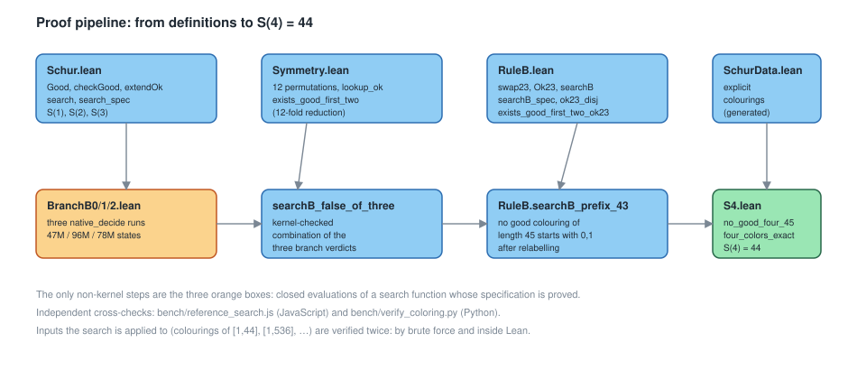
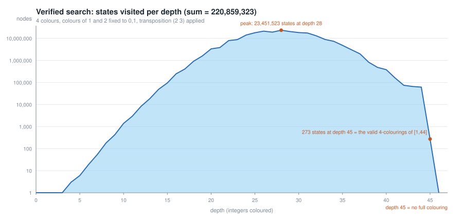
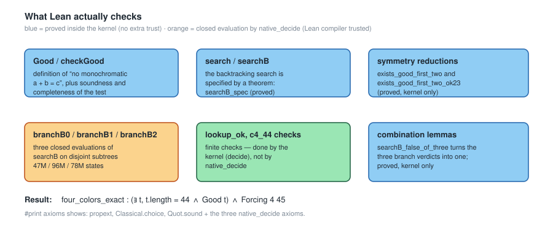

# S(4) = 44 — a verified exhaustive search in Lean 4

[](https://lean-lang.org/)
[](https://leanprover-community.github.io/)
[](LICENSE)

This repository contains a **complete machine-checked proof of the classical
Schur-number result**

> **S(4) = 44**, i.e. `{1, …, 44}` can be coloured with 4 colours without a
> monochromatic solution of `x + y = z`, but `{1, …, 45}` cannot.

The lower bound is an explicit colouring (Baumert–Golomb 1965).  The upper bound
is a **verified exhaustive search**: the search algorithm, its specification and
the symmetry reductions used to shrink the search space are all *theorems* in
Lean 4; the only non-kernel steps are three closed `native_decide` evaluations
of disjoint parts of the search tree.

```lean
-- S4.lean
theorem no_good_four_45 : ¬ ∃ t : List (Fin 4), t.length = 45 ∧ Good t
theorem four_colors_exact :
    (∃ t : List (Fin 4), t.length = 44 ∧ Good t) ∧ Forcing 4 45
```

Everything is checked with **Lean 4.33.1 alone** — no Mathlib, no external SAT
solver, no LRAT/DRAT certificate, no downloaded data.

If you are here to audit rather than to read, start with
[`docs/RIGOR.md`](docs/RIGOR.md): it separates what the kernel checks, the one
thing the proof trusts beyond the kernel (three closed `native_decide`
evaluations), and the independent cross-checks that are evidence but not proof.

### Theorem index

| file | theorem | statement |
|---|---|---|
| `Statement.lean` | `S4_statement` | `{1,…,44}` is sum-free colourable and `{1,…,45}` is not |
| `Statement.lean` | `S4_all_shorter` | every `N ≤ 44` is sum-free colourable |
| `S4.lean` | `no_good_four_45` | `∀ l, l.length = 45 → ¬ Good l` |
| `S4.lean` | `four_colors_exact` | `(∃ l, l.length = 44 ∧ Good l) ∧ Forcing 4 45` |
| `Schur.lean` | `search_spec` | the search succeeds exactly on the good colourings |
| `RuleB.lean` | `searchB_spec` | the reduced search succeeds exactly on the good `Ok23` colourings |
| `Symmetry.lean` | `exists_good_first_two` | 12-fold symmetry reduction |
| `RuleB.lean` | `exists_good_first_two_ok23` | 24-fold symmetry reduction |
| `Schur.lean` | `one/two/three_colors_exact` | `S(1)=1`, `S(2)=4`, `S(3)=13` |
| `Verify.lean` | — | prints the axiom/trust base of all of the above |

---

## Table of contents

1. [Result and conventions](#result-and-conventions)
2. [Proof pipeline](#proof-pipeline)
3. [How much search is really needed](#how-much-search-is-really-needed)
4. [Trust base](#trust-base)
5. [Reproducing the proof](#reproducing-the-proof)
6. [Repository layout](#repository-layout)
7. [What is *not* claimed](#what-is-not-claimed)
8. [References](#references)

---

## Result and conventions

Two conventions for Schur numbers are in use, differing by one:

| convention | definition | value |
|---|---|---|
| `S(4)` (OEIS [A045652](https://oeis.org/A045652)) | largest `N` such that `{1, …, N}` admits a 4-colouring with no monochromatic `x + y = z` | **44** |
| `S'(4)` (OEIS [A030126](https://oeis.org/A030126)) | least `N` such that *every* 4-colouring of `{1, …, N}` has one | **45** |

Both are proved here, as the pair `four_colors_exact`.

A colouring of `{1, …, N}` is represented as a `List (Fin 4)` of length `N`
(entry `i` is the colour of `i + 1`), and the property to be avoided is

```lean
def Good {r : Nat} (l : List (Fin r)) : Prop :=
  ∀ i j : Nat, i < l.length → j < l.length → i + j + 1 < l.length →
    l[i]? = l[j]? → l[i + j + 1]? ≠ l[i]?
```

which says exactly: no colour class contains `a`, `b`, `a + b`.

## Proof pipeline



1. **`Schur.lean`** — `Good`, the computable test `checkGood` together with its
   soundness *and* completeness (`checkGood l = true ↔ Good l`), the incremental
   feasibility check `extendOk`, the backtracking search `search`, and its
   specification

   ```lean
   theorem search_spec (n : Nat) (l : List (Fin r)) :
       search r n l = true ↔ ∃ t, t.length = n ∧ Good (l ++ t)
   ```

   The exact values `S(1) = 1`, `S(2) = 4`, `S(3) = 13` are decided here as well.

2. **`Symmetry.lean`** — a *proved* 12-fold reduction.  Since `1 + 1 = 2`, the
   first two colours of a good colouring differ, so some relabelling of `Fin 4`
   sends them to `0` and `1`:

   ```lean
   theorem exists_good_first_two (hg : Good t) (h2 : 2 ≤ t.length) :
       ∃ u, u.length = t.length ∧ Good u ∧ u[0]? = some 0 ∧ u[1]? = some 1
   ```

   The relabelling is found by a finite lookup in a list of 12 explicit
   permutations; the correctness of the lookup is checked **by the kernel**
   (`decide`), and relabelling invariance `Good (l.map f) ↔ Good l` is proved
   for injective `f` (`good_map_iff`).

3. **`RuleB.lean`** — a second *proved* reduction, 12-fold again.  After step 2
   the colours `2` and `3` are interchangeable, so we may require that colour
   `3` never occurs before colour `2` (`Ok23`):

   ```lean
   theorem ok23_disj (l : List (Fin 4)) : Ok23 l ∨ Ok23 (l.map swap23)
   theorem exists_good_first_two_ok23 (hg : Good t) (h2 : 2 ≤ t.length) :
       ∃ u, u.length = t.length ∧ Good u ∧ u[0]? = some 0 ∧ u[1]? = some 1 ∧ Ok23 u
   ```

   The restricted search is again specified by a theorem:

   ```lean
   theorem searchB_spec (hl : Ok23 l) :
       searchB n l = true ↔ ∃ t, t.length = n ∧ Good (l ++ t) ∧ Ok23 (l ++ t)
   ```

4. **`BranchB0/1/2.lean`** — the remaining search tree below the prefix `[0, 1]`
   has **220 859 322** states.  It is split into three disjoint branches
   according to the colour of the third integer, which can only be `0`, `1` or
   `2` (`hasTwo [0,1] = false`).  Each branch is a separate file, verified by one
   `native_decide`; the three files are independent and can be built in
   parallel.

5. **`S4.lean`** — the *proved* lemma `searchB_false_of_three` combines the three
   branch verdicts, giving `no_good_four_45`; together with the explicit
   `[1,44]` colouring (re-checked by the kernel with `decide`) this yields
   `four_colors_exact`.

## How much search is really needed

Search tree for `[1, 45]` with 4 colours (states visited; measured with
`bench/measure.js`, which is an independent JavaScript implementation of the
same recursion):

| reduction | states | factor | verified in Lean |
|---|---:|---:|---|
| none | 5 300 623 637 | 1× | — |
| colour of 1 fixed to `0` | 1 325 155 910 | 4× | — |
| first two colours fixed to `0,1` | 441 718 638 | 12× | reduction proved |
| **+ transposition `(2 3)`** | **220 859 322** | **24×** | **reduction proved, tree verified** |



The last figure is a useful sanity check: the deepest non-empty level has
exactly **273** states, and 273 is the published number of 4-colourings of
`{1, …, 44}` without a monochromatic sum (Eliahou 2016).  The search reaches
depth 45 with zero states, which is the theorem.

The three verified branches (see `bench/branches.js`):


Further pruning is possible in principle, but it must be *proved*: see
[`docs/OPTIMIZATION.md`](docs/OPTIMIZATION.md), which also documents one
plausible-looking pruning rule that is in fact **unsound** and is therefore not
used.

## Trust base



`Verify.lean` prints the axiom dependencies:

```
'Schur.four_colors_exact' depends on axioms: [propext, Classical.choice, Quot.sound,
    branchB0._native.native_decide.ax_1_1,
    branchB1._native.native_decide.ax_1_1,
    branchB2._native.native_decide.ax_1_1]
'Schur.exists_good_first_two' depends on axioms: [propext, Quot.sound]
'Schur.searchB_spec'          depends on axioms: [propext, Classical.choice, Quot.sound]
```

* `propext`, `Classical.choice`, `Quot.sound` are the standard axioms of Lean's
  logic.
* The three `native_decide` axioms are the three closed evaluations of the
  search on the branches.  Their *correctness as algorithms* is a theorem;
  what is trusted is that the Lean compiler evaluates them faithfully.
* Everything else — the search specification, both symmetry reductions, the
  combination lemma, and the `[1,44]` colouring — is checked by the kernel.

There is no external solver, certificate format or data file in the trust base.

## Reproducing the proof

Requirements: [`elan`](https://github.com/leanprover/elan) (the Lean toolchain
manager).  The repository pins `leanprover/lean4:v4.33.1` in `lean-toolchain`,
and has **no dependencies**, so no network access is needed after the toolchain
is installed.

```bash
lake build Schur Symmetry RuleB      # fast: the kernel-checked core
lake build BranchB0 BranchB1 BranchB2  # the three exhaustive branches (minutes)
lake build S4                         # assembly (seconds)
lake env lean Verify.lean             # print the axiom/trust base
```

A full `lake build` runs the three branches (they are independent, so `lake`
parallelises them).  Measured on the development machine (16 logical cores):

| step | wall clock |
|---|---|
| `Schur` + `Symmetry` + `RuleB` (kernel-checked core) | ≈ 10 s |
| `BranchB0` (47 033 043 states) | 588 s |
| `BranchB1` (95 553 318 states) | 1183 s |
| `BranchB2` (78 272 958 states) | 959 s |
| three branches in parallel | ≈ 20 min |
| `S4` + `Verify` (assembly and axiom check) | ≈ 3 s |

The per-branch timings are also recorded in `bench/branch_timings.txt`.

Independent cross-checks that do not use Lean at all:

```bash
node bench/measure.js AB 45 --profile    # 220 859 322 states, depth profile
node bench/branches.js 45                # 47 033 043 / 95 553 318 / 78 272 958
node bench/reference_search.js 4 45      # exhaustive search: 273 colourings of [1,44], 0 of [1,45]
python3 bench/verify_coloring.py bench/data/c4_44.txt   # brute-force check of the explicit colouring
python3 scripts/make_figures.py          # regenerate docs/figures/*.svg
```

## Repository layout

```
Schur.lean          definitions, checkGood, search + search_spec, S(1), S(2), S(3)
SchurData.lean      explicit colourings (generated, each verified twice)
Fin4.lean           every element of Fin 4 is 0, 1, 2 or 3
Symmetry.lean       12-fold reduction (kernel-checked)
RuleB.lean          24-fold reduction + restricted search searchB (kernel-checked)
BranchB0.lean       verified branch: colour of 3 is 0
BranchB1.lean       verified branch: colour of 3 is 1
BranchB2.lean       verified branch: colour of 3 is 2
S4.lean             no_good_four_45, four_colors_exact  (S(4) = 44)
Statement.lean      the same result with explicit lengths (readable form)
Verify.lean         axiom / trust-base report
docs/PROOF.md       proof process, step by step
docs/RIGOR.md       audit: kernel-checked vs trusted vs cross-checked
docs/CERTIFICATES.md self-written DPLL/RUP front-end and the proved checker
docs/OPTIMIZATION.md search-space analysis, including an unsound rule
docs/figures/*.svg  figures generated by scripts/make_figures.py
Resolution.lean     proved checker for resolution refutations (no sorry)
CertificateS3.lean  generated S(3) certificate (data)
CertCheckS3.lean    the S(3) certificate accepted by the proved checker
Encoding.lean       structural CNF + completeness ⇒ `Forcing 3 14` from the certificate
bench/              independent JavaScript / Python cross-checks
bench/sat/          CDCL solver (JS + Python), RUP/trim/expansion tools, checkers
scripts/            build and figure scripts
```

`SchurData.lean` is machine-generated: it contains the explicit colourings used
for the lower bounds (the `[1, 44]` colouring of this proof, plus two colourings
for `r = 5` and `r = 6` that come from the same tooling and belong to a companion
investigation of `S(6)`; they are *not* used by anything in the `S(4)` proof).

## What is *not* claimed

* **Not new mathematics.**  `S(4) = 44` is Baumert–Golomb (1965).  What is new
  here is the machine-checked formalisation: the search is a verified algorithm,
  not a trusted program.
* **The evaluation is not kernel-reduced.**  Three `native_decide` calls trust
  the Lean compiler (standard practice, and the reason the numbers appear as
  axioms in `#print axioms`).  The *specifications* those evaluations are fed
  into are kernel-checked theorems.  See [`docs/RIGOR.md`](docs/RIGOR.md) for the
  exact failure modes of that trust and for what would remove it.

  A CDCL solver written from scratch for this repository refutes the `S(4)`
  instance in 214 490 conflicts (≈ 12 s) and emits a **RUP certificate** that two
  independent implementations verify; the same pipeline, expanded into explicit
  resolution steps, is **accepted by a proved Lean checker** for the `S(3)`
  instance, where `Encoding.lean` turns it into the theorem
  `Schur.Forcing 3 14`.  The `S(4)` certificate itself has *not* been checked in
  Lean yet (expanding it would need ≈ 4.6 M resolution steps), so **the `S(4)`
  trust base is unchanged**.  Status, measurements and next steps:
  [`docs/CERTIFICATES.md`](docs/CERTIFICATES.md), audit:
  [`docs/RIGOR.md`](docs/RIGOR.md) §8.
* **`S(6)` is not touched here.**  The value of `S(6)` is a famous open problem;
  only `536 ≤ S(6) ≤ 1927` is known.  This repository is about `S(4)` only.
* The window-based pruning rule that "every 14 consecutive integers use all four
  colours" is **false** as a consequence of `S(3) = 13`; see
  [`docs/OPTIMIZATION.md`](docs/OPTIMIZATION.md).

## References

* L. Baumert, S. Golomb, *Backtrack programming*, J. ACM 12 (1965) 516–524.
* I. Schur, *Über die Kongruenz x^m + y^m ≡ z^m (mod p)*, Jahresber. Deutsche
  Math.-Verein. 25 (1916) 114–116.
* M. J. H. Heule, *Schur Number Five*, AAAI 2018 — `S(5) = 160`, and a discussion
  of upper bounds for higher `S(k)`.
* S. Eliahou, *Les nombres de Schur, des centenaires pleins d'avenir*, Images des
  Mathématiques (2016) — includes the count of 273 four-colourings of `{1, …, 44}`.
* OEIS [A045652](https://oeis.org/A045652) (`S(r)`) and
  [A030126](https://oeis.org/A030126) (`S'(r)`).

## License

[MIT](LICENSE).
