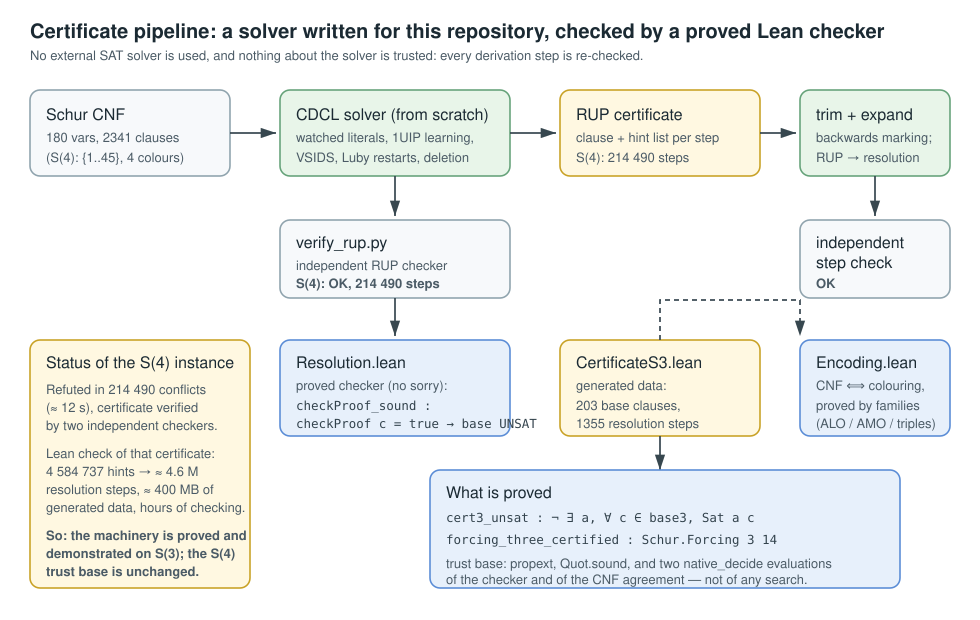

# Certificates: a self-written DPLL/RUP front-end and a proved checker

This document records the attempt to remove the remaining trust boundary of the
`S(4)` proof (three `native_decide` evaluations) by producing a *refutation
certificate* with a solver written for this repository and checking it with a
proved Lean checker.  It states exactly what works, what is trusted, and what is
still missing.



## 1. The pipeline

```
                     bench/sat/cdcl45.js            bench/sat/trim_proof.py
Schur CNF ──► CDCL solver (from scratch) ──► RUP proof ──► trimmed proof
               watched literals, 1UIP                │            │
               learning, positional or VSIDS         │            ▼
               branching, Luby restarts              │   expand_resolution.py
                                                      │   (RUP → resolution,
                                                      │    each step checked)
                                                      ▼            │
                                        verify_rup.py (independent) │
                                                                    ▼
                                              Resolution.lean: proved checker
                                              checkProof_sound : checkProof c = true
                                                → ¬ ∃ a, ∀ cl ∈ c.base, Sat a cl
```

* `bench/sat/cdcl45.js` — CDCL SAT solver written from scratch (no external SAT
  solver).  Clauses live in flat typed arrays so that multi-million-conflict runs
  fit in memory.  It emits a RUP proof: for each derived clause, a hint list
  whose clauses must be unit one after another until one is falsified.
* `bench/sat/cdcl45.py` — the original Python implementation of the same solver
  (same algorithm and certificate format, useful as a second implementation).
* `bench/sat/verify_rup.py` — independent RUP checker (separate implementation).
* `bench/sat/trim_proof.py` — trims a certificate to the clauses the refutation
  needs (backwards marking from the empty clause; all unit clauses are kept,
  since they seed unit propagation).
* `bench/sat/expand_resolution.py`, `bench/sat/gen_lean_cert.py` — turn the RUP
  proof into explicit resolution steps and emit Lean data.
* `Resolution.lean` — the proved checker: only two inference rules (`resolve`,
  `weaken`), with

  ```lean
  theorem checkProof_sound (h : checkProof cert = true) :
      ¬ ∃ a, ∀ c ∈ cert.base, Sat a c
  ```

  no `sorry`, and no axioms beyond the standard ones.
* `Encoding.lean` — the structural CNF and the completeness direction, giving
  `forcing_three_certified : Schur.Forcing 3 14` (see §3).

## 2. The `S(4)` instance is refuted, with a certificate

`{1, …, 45}` with 4 colours, 180 variables, 2341 clauses, 12-fold symmetry
reduction (`--sym`, justified by `Schur.exists_good_first_two`):

| quantity | value |
|---|---|
| solver result | **UNSAT**, 214 490 conflicts, ≈ 12 s |
| branching | positional (colours of 1, 2, 3, … in order) |
| RUP certificate | 214 490 steps, 34 MB (regenerated deterministically in 13 s) |
| independent RUP check | **OK** (`verify_rup.py`: 214 490 steps, database 216 831 clauses) |
| trimmed certificate | 205 521 steps (95.8 %), independently verified |
| resolution expansion | 4 584 737 hints ⇒ ≈ 4.6 M resolution steps |
| Lean check of that certificate | **not done**: see §4 |

With activity-based (VSIDS) branching the same solver needs 2 308 148 conflicts
(≈ 215 s), so the positional order is worth a factor of ten here; with the Python
implementation the same instance did not converge at all within 4 000 000
conflicts (≈ 48 min).

Two engineering bugs were found by the certificate checks themselves and are
worth recording, because they show the checks are not decorative:

1. the fast hint generation (reasons read off the conflict-analysis chain) was
   only valid once *learned unit clauses* were registered as unit clauses: the
   checker seeds the trail with all of them, so a missing registration makes the
   replayed propagation strictly weaker than the checker's.  Before the fix the
   solver failed to certify one clause in ≈ 10⁵ and never refuted the instance;
   after it, every one of the 214 490 clauses certifies (0 fallbacks, 0 drops);
2. the JavaScript encoder initially interleaved ALO/AMO clauses while the Python
   encoder emits them in blocks, so hint indices referred to a different database
   — caught immediately by `verify_rup.py` (line 1).

## 3. What is checked end to end in Lean: the `S(3)` instance

`{1, …, 14}` with 3 colours (42 variables, 203 clauses):

| quantity | value |
|---|---|
| solver result | UNSAT, 128 conflicts, 0.2 s |
| RUP certificate | 128 steps, 1433 hints (7.9 KB) |
| independent RUP check | OK |
| expanded derivation | 1355 resolution/weakening steps |
| **Lean check** | `CertCheckS3.lean`: `checkProof cert3 = true` by the proved checker |
| **Lean theorem** | `Encoding.forcing_three_certified : Schur.Forcing 3 14` |
| trust base | `propext`, `Quot.sound`, `cert3_checks` and `base3_eq` (two `native_decide` evaluations: the checker on explicit data, and the agreement between the generated CNF and the structural one) |

`Encoding.lean` contains:

* `cnf3` — the encoding defined *structurally* (ALO, AMO and triple clause
  families), proved equal to the generated `Resolution.base3` by `native_decide`;
* `mkAssign` — the assignment induced by a colouring, with
  `mkAssign_atom : mkAssign t (apos i c) = decide (c = col t i)`;
* `aloSat`, `amoSat`, `tripleSat` — each family of clauses is satisfied by a good
  colouring (`tripleSat` is where `Schur.Good` is used);
* `dedup_sat` — deduplication preserves satisfaction;
* `cnf3_unsat` and `forcing_three_certified`.

So for `S(3) = 13` the trust base is now: Lean's standard axioms, a ~250-line
proved checker, and the evaluation of that checker on explicit data — instead of
a search evaluation.

## 4. What is still missing for `S(4)`

The `S(4)` refutation is verified by two *independent* implementations (the RUP
checker and the expansion checker), but it is not yet checked by the Lean
checker, for a purely quantitative reason: expanding its 4 584 737 hints into
explicit resolution steps produces ≈ 4.6 M steps — roughly 400 MB of generated
Lean data and hours of `native_decide` checking (extrapolating from the `S(3)`
ratio, where 1433 hints gave 1355 steps checked in ≈ 3 s).

Two ways to close it, in order of value:

1. **A proved RUP checker in Lean** (`Rup.lean`): the RUP certificate is 34 MB
   (9 MB gzipped) instead of ≈ 400 MB expanded, and checking 214 490 steps is a
   single pass.  The obstacle is purely formal: the soundness proof needs the
   trail invariant ("every assignment satisfying the base and falsifying the
   step's clause makes the whole trail true"), which survived two attempts here
   but was not finished.  Two independent Python checkers already validate the
   format, so the remaining work is the Lean proof.
2. **A smaller certificate**: better branching/heuristics (clause minimisation,
   phase saving variants, restarts) could reduce the conflict count and hence the
   expansion.  The current solver needs 214 490 conflicts; a factor of 10–20
   would make the expansion route practical.

Until one of them is done, the honest summary is: *the `S(4)` refutation has a
machine-checked certificate verified by independent checkers, but that
certificate has not been checked by the proved Lean checker, so the trust base of
`S4_statement` in `docs/RIGOR.md` §3 is unchanged.*

`KernelCheckS3.lean` records the measurement for the *kernel* route: asking the
kernel (`decide`, not `native_decide`) to evaluate `checkProof cert3` does not get
through the 1995-step `S(3)` certificate within the default heartbeat budget
(timeout at 200 000 heartbeats, ≈ 13 s), and a raised budget did not finish
either.  `native_decide` on the checker is therefore the practical choice, and
the trust it requires is evaluation of a ~250-line proved checker rather than of
a search.

## 5. Reproducing

```bash
# S(3): solver → independent check → Lean data → Lean checker → theorem
cd bench/sat
node cdcl45.js --problem s3 --out proof_s3.rup --stats
python3 verify_rup.py --proof proof_s3.rup --problem s3
python3 gen_lean_cert.py --problem s3 --proof proof_s3.rup \
        --lean ../../CertificateS3.lean --name 3
cd ../.. && lake build CertCheckS3 Encoding

# S(4): the refutation and its independent checks (≈ 15 s + ≈ 10 s)
cd bench/sat
node cdcl45.js --sym --problem s4 --order positional --out proof45_js.rup --stats
python3 verify_rup.py --proof proof45_js.rup --problem s4 --sym
python3 trim_proof.py --proof proof45_js.rup --problem s4 --sym --out proof45_trim.rup

# what the Lean check of the S(4) certificate would cost
python3 expand_resolution.py --proof proof45_trim.rup --problem s4 --sym --out cert45.txt
```

The large generated files (`proof45*.rup`, `cert45.txt`) are git-ignored: they
are reproduced deterministically by the commands above.
