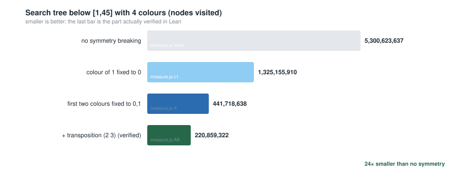
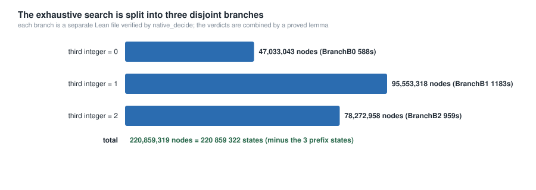

# How much search, and how it was optimised

Everything in this document is measured, not estimated.  All node counts come
from `bench/measure.js`, an independent JavaScript implementation of the same
recursion as the Lean function (same pruning, same state-counting convention:
a state is counted when the search is entered).

## 1. Effect of the reductions

Search for `[1, 45]` with 4 colours:

| # | restriction | states | factor | status |
|---|---|---:|---:|---|
| 0 | none | 5 300 623 637 | 1× | measured only |
| 1 | colour of `1` fixed to `0` | 1 325 155 910 | 4× | measured only |
| 2 | first two colours fixed to `0, 1` | 441 718 638 | 12× | **reduction proved** (`Symmetry.lean`) |
| 3 | + colour `3` only after colour `2` | **220 859 322** | **24×** | **reduction proved** (`RuleB.lean`), tree verified |



Reproduce with:

```bash
node bench/measure.js none 45     # 5 300 623 637   (~4 min)
node bench/measure.js c1   45     # 1 325 155 910   (~80 s)
node bench/measure.js A    45     #   441 718 638   (~15 s)
node bench/measure.js AB   45     #   220 859 322   (~15 s)
```

Reduction 2 is sound because `Good` only compares colours for equality, so an
injective relabelling preserves it; the required permutation exists because
`1 + 1 = 2` forces the first two colours to differ.  Reduction 3 is sound
because the transposition `(2 3)` fixes `0` and `1`, so it acts on the colourings
left over from reduction 2; every colouring either already satisfies "`3` never
before `2`", or its image under the transposition does (`ok23_disj`).  Neither
argument enumerates anything in the kernel: the only finite check is the
12-permutation lookup table, and that is discharged by `decide` (the kernel),
not by `native_decide`.

## 2. A tempting rule that is *unsound* (and therefore unused)

It is tempting to prune with the following rule.

> **(W)** In a good 4-colouring of `[1, N]`, every 14 consecutive integers use
> all four colours — otherwise the window is a good 3-colouring of 14 integers,
> contradicting `S(3) = 13`.

The rule is **false**, and the argument is invalid: translating a window
`[i, i + 13]` down to `[1, 14]` does not preserve the equation `a + b = c`,
because `a + b` may leave the window.  For example, in the window `[15, 28]`
the sum `15 + 15 = 30` lies outside, so internal sums constrain the window much
less than they constrain `[1, 14]`.

A concrete counterexample is produced by `bench/window_check.js`, which
enumerates good 4-colourings and reports windows using at most three colours:

```
$ node bench/window_check.js 44 14
good 4-colouring of [1,44] violating the window rule: window [15,28] uses only 3 colours
   colouring: 0 1 0 2 0 3 1 3 2 1 2 2 3 2 0 1 0 3 0 3 1 3 3 1 3 0 3 0 1 1 2 3 2 2 1 2 3 1 2 0 2 0 1 0
...
344 of the good 4-colourings of [1,44] violate the window rule
```

So rule (W) is not used anywhere in the proof.  (An early experiment measured
how much it *would* prune — 441 718 638 → 359 303 374 states — but those numbers
describe an unsound heuristic and are therefore not part of the result.)

This is a small illustration of the point of the exercise: in a formal
development, a plausible-looking reduction has to be *proved*, and this one
cannot be.

## 3. Where the remaining time goes

The verified tree has 220 859 322 states.  The three branches are:

| branch | third integer | states | measured wall clock (`native_decide`) |
|---|---|---:|---|
| `BranchB0.lean` | `0` | 47 033 043 | see `bench/branch_timings.txt` |
| `BranchB1.lean` | `1` | 95 553 318 | see `bench/branch_timings.txt` |
| `BranchB2.lean` | `2` | 78 272 958 | see `bench/branch_timings.txt` |



The bottleneck is *not* the size of the tree but the cost per state of the
list-based implementation used here: `extendOk` inspects
`l[i]?` and `l[l.length - 1 - i]?` for every `i`, and `List.getElem?` is a
linear traversal, so one call costs `O(k²)`; appending `l ++ [x]` copies the
prefix (`O(k)`).  The JavaScript reference implementation uses a mutable array
and does `O(k)` work per state with `O(1)` indexing:

| implementation | states / second | seconds for the whole 220 859 322-state tree |
|---|---:|---:|
| JavaScript, mutable array (`bench/measure.js AB 45`) | ≈ 15 500 000 | 14.3 |
| Lean, list-based (`native_decide`, three branches) | ≈ 81 000 | ≈ 45 min in total (≈ 20 min in parallel) |

i.e. the Lean evaluation is about **190× slower per state** (≈ 12 µs versus
≈ 64 ns).

Two concrete, measurable improvements for a future revision (neither is needed
for correctness):

1. **Bit-mask state.**  For `r = 4` and `N = 45` a colour class fits in a
   46-bit `Nat`.  Maintaining, for each colour, the mask of coloured integers
   and the mask of *blocked* integers (those that would complete a
   monochromatic triple) makes the feasibility test a single bit test and the
   update an `O(k)` bitwise loop with no allocation.  Estimated per-state cost:
   ≈ 1 µs instead of ≈ 12 µs, i.e. the three branches would take about a minute
   in total.
2. **Prepend instead of append.**  Keeping the colouring in reverse order makes
   the extension step `O(1)`; the feasibility check uses the same symmetric
   pair pattern, since `(l ++ [x])` reversed is `x :: l.reverse`.

Both require new proofs (the specification of the search has to be re-derived
for the new state representation), which is why they are documented rather than
implemented here.

## 4. What *was* optimised

* **24× smaller search tree** by two proved symmetry reductions.
* **Parallel verification**: the tree is split into three disjoint branch files,
  so the expensive evaluations run concurrently and the assembly step takes
  seconds.
* **Kernel-checked where it is cheap**: the symmetry lookup table, the
  `[1, 44]` colouring, and every logical step run in the kernel; only the three
  large closed evaluations use `native_decide`.
* **Reproducible measurement**: the node counts in the tables above are produced
  by scripts in `bench/`, and the figures of `docs/figures/` are generated from
  those measurements by `scripts/make_figures.py`.
